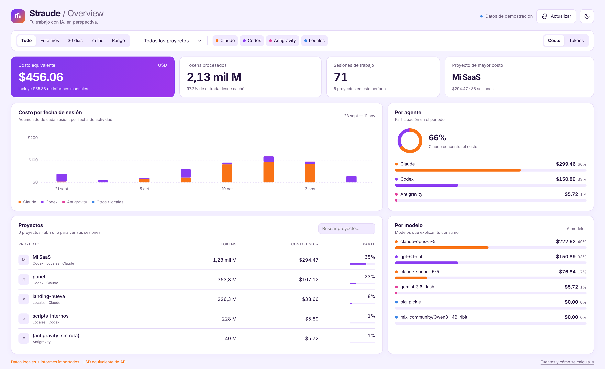
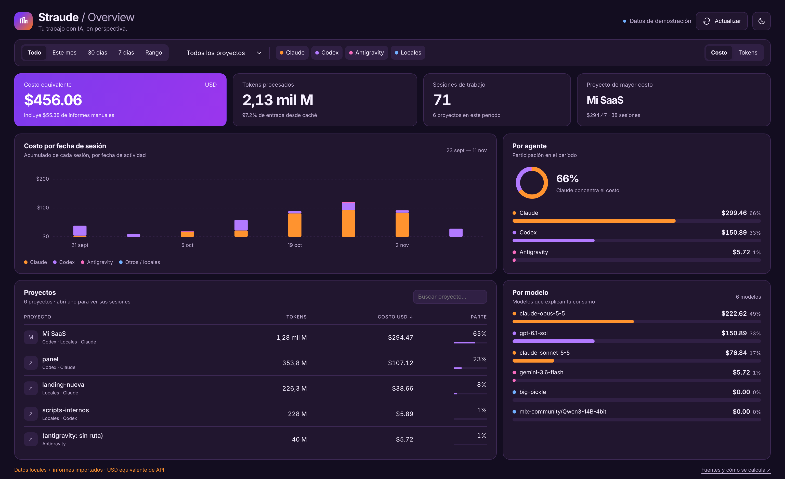

# Straude Dashboard

Un dashboard local para ver, en un solo lugar, **todo lo que consumís con agentes de IA**: Claude Code, Codex, Antigravity, OpenCode y los modelos que corras en tu propia máquina. Costo equivalente, tokens, sesiones y proyectos.

Corre en tu Mac, lee archivos que ya están en tu disco y **no manda nada a ningún servidor**.



```
./install.sh    # una vez
./start.sh      # http://localhost:8934
```

### Probalo sin instalar nada

```bash
git clone https://github.com/axellaban/straude-dashboard.git
cd straude-dashboard && ./demo.sh
```

Abre el dashboard con datos inventados. No necesita ccusage, ni Node, ni que tengas historial de uso: es para ver si te sirve antes de conectarlo a tus datos.

<details>
<summary>Modo oscuro</summary>



</details>

---

## Por qué

Cada agente te muestra su propio consumo, en su propio formato, y ninguno te dice cuánto te costó *el proyecto* en el que estuviste trabajando toda la semana. Si usás tres o cuatro agentes a la vez, no tenés un número.

Este dashboard junta todas las fuentes locales en una sola vista:

- **Costo equivalente en USD** por período, proyecto, agente y modelo
- **Tokens procesados**, con el porcentaje que entró desde caché (el número que más mueve la aguja y que casi nadie mira)
- **Una fila por sesión real**, con la ruta del proyecto en el que corrió
- Modo claro y oscuro, filtros por período y por agente, y auto-refresh cada 45 segundos

### Una aclaración importante sobre los costos

**Los importes son el equivalente a precios de API, no lo que te cobran.** Si trabajás con una suscripción Pro o Max, ese número *no* es un cargo: es cuánto costaría el mismo trabajo pagado por API. Sirve para comparar proyectos entre sí y para entender qué te está saliendo caro — no para conciliar tu tarjeta.

Los modelos locales y gratuitos figuran con costo cero. Si aparece un modelo sin tarifa conocida, el dashboard lo avisa en el pie en vez de inventar un número.

---

## Requisitos

| | |
|---|---|
| **macOS** | El dashboard y ccusage andan en Linux también. El launcher de un clic y el extractor de sesiones remotas son solo para Mac. |
| **Python 3.9+** | El que viene con macOS alcanza. Sin dependencias para el modo básico. |
| **Node.js** | Para [ccusage](https://github.com/ryoppippi/ccusage), que es de donde salen los datos. |

---

## Instalación

```bash
git clone https://github.com/axellaban/straude-dashboard.git ~/straude-dashboard
cd ~/straude-dashboard
./install.sh
```

El instalador es interactivo y te pregunta paso a paso (`./install.sh --yes` acepta todo). Hace esto:

1. Verifica Python y el sistema
2. Instala `ccusage` global con npm si no lo tenés (si decís que no, cae a `npx`, más lento)
3. Opcional: crea `.venv-chatextract/` para el extractor de sesiones remotas
4. Opcional: crea tu `config.json` a partir del ejemplo
5. Opcional: compila **Straude Dashboard.app**, un launcher de un clic para el Dock

> El launcher espera el proyecto en `~/straude-dashboard`. Si lo clonaste en otra ruta, editá `launcher.applescript` y volvé a correr el instalador.

### Dos formas de usarlo

```bash
./start.sh      # servidor en vivo en localhost:8934, se refresca solo
./refresh.sh    # snapshot: genera dashboard.html una vez y lo abre
```

El servidor es lo que querés casi siempre: recalcula en segundo plano cada 45 segundos y el botón "Actualizar" fuerza una lectura fresca con precios en vivo. El snapshot sirve para guardar o compartir una foto de un momento (ojo: ese HTML lleva tus datos adentro).

La primera carga tarda unos 15-20 segundos mientras ccusage escanea el disco. Después es instantáneo.

---

## Configuración

Todo es opcional. Sin configurar nada, el dashboard ya funciona: cada carpeta aparece como su propio proyecto.

### `config.json` — agrupar y destacar proyectos

```bash
cp config.example.json config.json
```

```json
{
  "port": 8934,
  "projectAliases": {
    "Mi SaaS": "mi-saas",
    "Cliente X": "clientes/x(?![a-z0-9])"
  },
  "highlightProject": "Mi SaaS",
  "backgroundIntervalSeconds": 45
}
```

`projectAliases` es lo más útil: unifica bajo un mismo nombre todas las sesiones cuya ruta matchee esa expresión regular. Si un proyecto vive en tres carpetas distintas, o lo trabajaste desde dos cuentas, con un alias lo ves como uno solo. `highlightProject` lo pone primero en el selector.

### `manual_sessions.json` — cargar lo que ninguna fuente ve

```bash
cp manual_sessions.example.json manual_sessions.json
```

Para sumar a mano sesiones que no quedaron registradas localmente: una segunda cuenta en otra máquina, trabajo anterior a instalar el dashboard. Quedan marcadas como **informe manual**, separadas de lo medido, y podés dejar una nota explicando de dónde salió cada dato.

### Tarifas

Ver **[PRICING.md](PRICING.md)** para la tabla actual, de dónde sale cada precio y cómo actualizarlo. Las tarifas se editan en dos archivos: `ccusage.json` (costo por token, lo que usa ccusage para calcular) y `pricing_sources.json` (USD por millón más la fuente, lo que el dashboard te muestra).

---

## De dónde salen los datos

| Fuente | Qué aporta |
|---|---|
| `ccusage --json` | Agente, modelos, tokens, costo y fecha de cada sesión |
| `~/.claude/projects/*/<id>.jsonl` | La carpeta real de cada sesión de Claude Code |
| `~/.codex/sessions/*.jsonl` | Lo mismo para Codex |
| `~/.local/share/opencode/opencode.db` | Lo mismo para OpenCode y modelos locales por mlx |
| Caché de la app de Escritorio | Sesiones de Cowork/Code que corrieron en la nube (opcional) |

Esa última fuente merece una explicación. Las sesiones que lanzás desde la app de Escritorio y corren en un sandbox remoto **nunca tocan `~/.claude/projects`**, así que ccusage no las ve y desaparecen de tu consumo. La app cachea esas conversaciones localmente para mostrarte el historial, y esa copia incluye el uso real por turno. `extract_desktop_conversations.py` lo lee de ahí, en una copia de solo lectura, y recupera lo que faltaba.

Es un formato interno no oficial de Chromium, así que puede romperse cuando cambie la app. Está escrito para fallar en silencio: si no puede leer, el dashboard sigue andando sin esa fuente en lugar de caerse.

### Lo que el dashboard *no* puede medir

Es honesto sobre sus límites, y vos también deberías serlo al leerlo:

- **Las conversaciones de chat normales no tienen tokens.** Los planes Pro/Max no exponen ese dato por mensaje, ni acá ni en ningún lado local. Solo aparece el trabajo con agentes.
- **Antigravity no tiene fuente local de proyectos**, así que sus sesiones quedan agrupadas sin desglose por carpeta, y sus modelos usan correspondencias estimadas.
- **El gráfico temporal no es gasto diario.** Agrupa el acumulado completo de cada sesión en su última fecha de actividad. Una sesión de tres días aparece entera el último día.

---

## Privacidad

Lo que mide este dashboard es información bastante íntima sobre cómo trabajás: en qué proyectos, cuánto, qué días. Por eso:

- **Nada sale de tu máquina.** No hay telemetría, no hay llamadas a ninguna API propia. ccusage corre con `DO_NOT_TRACK=1`. La única salida a internet es la consulta de precios de ccusage, que podés evitar con el modo offline.
- **El `.gitignore` ya protege tus datos.** `data.json`, `dashboard.html`, `backups/`, `config.json` y `manual_sessions.json` están excluidos. Si forkeás este repo, tu consumo no se publica por accidente.
- **Cuidado con `dashboard.html`.** El snapshot lleva todos tus datos embebidos en el archivo. No lo subas a ningún lado sin mirarlo.

---

## Y Straude, el de la nube

Esto es el dashboard **local**. Es un complemento de [Straude](https://straude.com), el CLI que publica tus stats de Claude Code a un leaderboard global, al estilo Strava:

```bash
npx straude@latest     # autentica por browser y guarda el token en ~/.straude/config.json
straude                # sincroniza
```

Son independientes: el dashboard funciona sin Straude, y Straude funciona sin el dashboard. Van juntos porque responden preguntas distintas — Straude te dice cómo venís contra el resto, el dashboard te dice en qué se te fue el mes.

> Tu `~/.straude/config.json` contiene un token de sesión. Nunca lo copies a un repo.

---

## Problemas comunes

**La primera carga tarda muchísimo o no termina.**
ccusage escanea tu disco. La primera vez son 15-20 segundos; si no lo tenés instalado global, cada corrida resuelve la versión por red y es bastante más lento. Corré `npm install -g ccusage`.

**El launcher no abre nada.**
Mirá `/tmp/straude-dashboard.log`. Lo más común es que el proyecto no esté en `~/straude-dashboard`, que es donde el AppleScript lo busca.

**Aparece "sin tarifa para X".**
Un modelo nuevo que ccusage todavía no conoce. Agregalo a `ccusage.json` y `pricing_sources.json` como explica [PRICING.md](PRICING.md).

**Mis sesiones de Cowork no aparecen.**
Necesitás el extractor opcional: volvé a correr `./install.sh` y aceptá el paso 3.

**Un proyecto aparece partido en varias filas.**
Son carpetas distintas. Unificalas con un alias en `config.json`.

---

## Si querés tocarlo

```bash
python3 tests/smoke_test.py    # levanta el server con datos falsos y chequea las rutas
python3 demo/make_demo.py      # regenera los datos de demo (deterministas, semilla fija)
```

El test no necesita ccusage ni historial, así que corre en cualquier máquina. Los datos de demo se calculan con las tarifas reales de `pricing_sources.json`, así que los números cierran si los verificás a mano.

Las piezas: `extract_data.py` arma el dataset, `project_sessions.py` consolida y aplica alias, `template.html` es todo el frontend en un archivo (sin build, sin dependencias), `server.py` lo sirve y lo refresca, `config.py` lee tu `config.json`.

## Licencia

MIT — usalo, modificalo, compartilo. Si lo mejorás, un PR es bienvenido.
